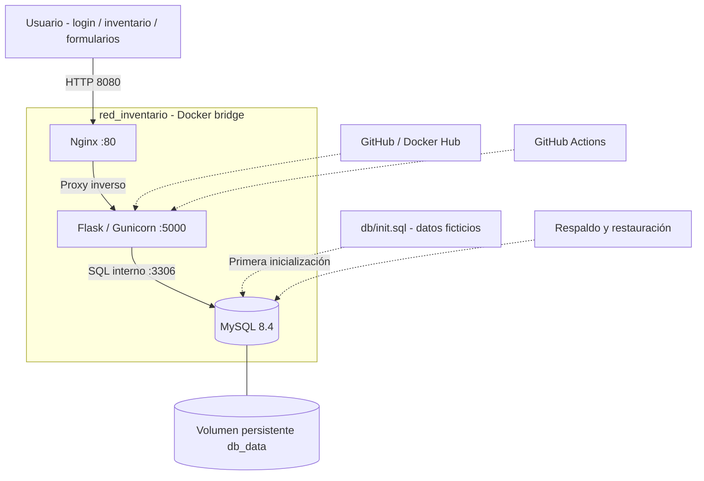

# Arquitectura del proyecto final

## Qué hace cada componente

- **Nginx** publica el único puerto accesible desde el equipo anfitrión (`HTTP_PORT=8080` hacia `:80`).
- **Flask** sirve el login, los filtros, los formularios de altas y ediciones, la baja lógica, el historial y la comprobación `/health`.
- **MySQL** utiliza cuatro tablas: `equipos`, `tipos_equipo`, `estados`, `movimientos`.
- **Volumen db_data** conserva el contenido de `/var/lib/mysql` aunque se reinicien o recreen los contenedores.
- **Red red_inventario** permite que `nginx`, `app` y `db` se comuniquen internamente. Los puertos 5000 y 3306 no se publican al anfitrión.
- **Operación del proyecto**: versionado/publicación de imagen, validación automática y respaldo/restauración.
